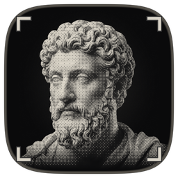
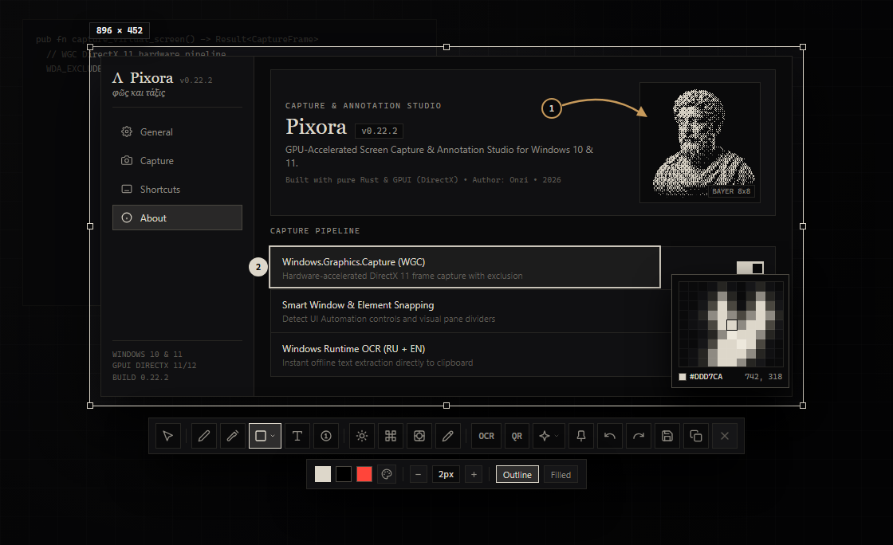

<div align="center">



# Pixora

**Next-Generation, GPU-Accelerated Screen Capture & Annotation Studio for Windows and Linux**

*A clean, blisteringly fast CleanShot X alternative built with pure Rust & GPUI.*

[English](README.md) • [Русский](README.ru.md)

[](https://www.rust-lang.org/)
[-blueviolet.svg?style=flat-square)](https://github.com/zed-industries/zed)
[-0078D6.svg?style=flat-square)](https://github.com/Onzis/Pixora)
[](https://github.com/Onzis/Pixora/releases)
[](https://github.com/Onzis)
[](https://www.apache.org/licenses/LICENSE-2.0)

---



*Pixora in action: CleanShot-style floating toolbar, real-time pixel magnifier, and rich annotation canvas.*

---

</div>

## Overview
**Pixora** is a professional, high-performance screen capture and annotation utility engineered for **Windows (10 & 11)** and **Linux (Wayland & X11)**. Inspired by the fluid elegance of macOS CleanShot X, Pixora brings pixel-accurate capture, rich vector annotations, offline OCR, smart element snapping, and instant clipboard sharing into a lightweight, native desktop tool.

Pixora runs **100% offline and local**. Zero telemetry, zero web bloat, zero background servers.

---

## Built With (Tech Stack)
Pixora is architected from the ground up for extreme responsiveness, minimal memory usage, and zero runtime dependencies:

- **Language:** **Pure Rust (Edition 2024)** - memory-safe, fearless concurrency, zero garbage collection pauses.
- **UI Framework:** **[GPUI](https://github.com/zed-industries/zed)** - Zed's state-of-the-art GPU-accelerated rendering engine utilizing DirectX 11/12 on Windows and Vulkan on Linux. Delivers smooth 60+ FPS interactions, custom vector icons, and sub-millisecond input responsiveness.
- **Windows Platform Layer:** Direct **Win32 & WinRT APIs** (`windows-rs` 0.61):
  - **Windows.Graphics.Capture (WGC):** Hardware-accelerated DirectX 11 capture pipeline with multi-monitor composition, protected content capture, and hardware exclusion via `SetWindowDisplayAffinity(WDA_EXCLUDEFROMCAPTURE)`.
  - **GDI BitBlt Fallback:** Instant fallback for virtual desktop capture across any display topology.
  - **Windows Runtime OCR (`Windows.Media.Ocr`):** Hardware-accelerated local optical character recognition.
  - **Per-Monitor V2 HiDPI Awareness:** Crisp pixel-to-pixel rendering on high-resolution displays (100%-300% DPI).
  - **Shell NotifyIcon & RegisterHotKey:** Native background system tray integration and low-latency global shortcut hooks.
- **Linux Platform Layer:**
  - **Capture Engines:** Pure Rust direct X11 root window capture via `x11rb` (`ZPixmap` BGRA to RGBA) with 0ms latency; native Wayland compositors support via `grim`, `gnome-screenshot`, and `spectacle`; automatic fallback to `scrot`, `maim`, and ImageMagick `import`.
  - **Clipboard Integration:** Asynchronous clipboard exchange supporting `wl-clipboard` (`wl-copy`, `wl-paste`), native `x11-clipboard`, and `xclip` for both PNG images and text.
  - **OCR Engine:** Local Tesseract OCR integration with TSV word/line layout extraction (`rus+eng`).
  - **IPC & CLI Daemon:** Single-instance UNIX domain socket listener (`/tmp/pixora-<uid>.sock`) for desktop shortcut triggers.
  - **Desktop Integration:** Freedesktop standard XDG `.desktop` entry, `~/.config/autostart` launcher, `zenity`/`kdialog` file choosers, and `notify-send` toasts.
- **Binary Footprint:** Standalone native executable. **Zero Electron, Zero Tauri, Zero WebView, Zero Python, Zero Node.js.** Idle RAM footprint is under 40 MB.

---

## Key Features

### 1. Precision Screen Capture & Multi-Monitor Support
- **Custom Area Capture:** Fluid, pixel-level selection with interactive dimension indicators (Width x Height).
- **Fullscreen Snapshot:** Instant capture of the entire virtual desktop spanning all displays (`Shift + PrintScreen`).
- **Active Window Capture:** One-click snapshot of the foreground focused window (`Alt + PrintScreen`).
- **Smart Window & Element Snapping:** Detects active windows, child controls, and UI panes using Windows UI Automation, X11 client trees, and pure-Rust visual edge detection (`detect_visual_panes`).
- **Hardware Capture Exclusion:** Pixora's overlay and windows are excluded from being captured on Windows 10/11 using `WDA_EXCLUDEFROMCAPTURE`.
- **True Multi-Display:** Handles negative display coordinates, mixed resolutions, and per-monitor DPI scaling without distortion.

### 2. CleanShot X Aesthetic Overlay & Smart Loupe
- **Frameless Dark Glass Interface:** Obsidian dark theme (`#0B0B0D` / `#151519` / `#8174FF`) with smooth rounded corners.
- **8-Handle Interactive Resize:** Drag edges or corners with automatic coordinate normalization in any direction.
- **Pixel Loupe & Eyedropper:** Real-time magnification lens showing individual pixel grid, live coordinates (X, Y), and instant color sampling.
- **Adaptive Floating Toolbar:** Auto-centers above or below the selection with strict boundary clamping to keep controls on-screen at all times.
- **Tooltips:** Responsive hover descriptions for every tool and action.

### 3. Comprehensive Annotation Arsenal
- **Freehand Pencil:** Smooth freeform sketching with customizable line weight.
- **Marker / Highlighter:** Translucent highlighter layer (35% opacity) for document review and code callouts.
- **Arrow:** Vector arrows with clean triangular arrowheads and curved Bezier guides.
- **Straight Line:** Straight guide lines at any angle.
- **Rectangle:** Outlined or solid filled bounding boxes with rounded corners.
- **Ellipse / Circle:** Smooth cubic Bezier curves with optional fill.
- **Text Tool:** Interactive inline text editor with free transform resizing handles, multiline wrapping, and Cyrillic/Russian keyboard support.
- **Step Badges (Counters):** Auto-incrementing circular numbered badges (1, 2, 3...) or alphabetical badges (A, B, C...) for step-by-step tutorials.
- **Dual-Pass Gaussian Blur:** Hide confidential data with adjustable blur radius and quick presets (`Soft 6px`, `Medium 12px`, `Strong 24px`, `Heavy 36px`).
- **Mosaic Pixelate:** Mosaic block redaction with stepped sizing controls (`[-] 10px [+]`) and quick presets.
- **Stroke Width Adjustment:** Fine-grained line weight from 1 to 48 px via `[-]` / `[+]` buttons, presets, or mouse wheel.
- **Non-Destructive History:** Infinite Undo (`Ctrl + Z`) and Redo (`Ctrl + Y`) without degradation of the base image.

### 4. RGB Color Studio & Spectrum Picker
- **24-Bit Full Spectrum (16.7 Million Colors):** Pick any color imaginable.
- **360° Rainbow Hue Bar:** Smooth continuous spectrum with real-time HSV-to-RGB conversion.
- **Discrete Channel Controls:** Individual sliders and stepper buttons (`-10`, `-1`, `+1`, `+10`) for Red, Green, and Blue channels (0-255).
- **Multi-Format Color Readout:** Live HEX (`#RRGGBB`), RGB, HSV, and HSL values with direct keyboard input and 1-click **Copy HEX** button.
- **Quick Swatches:** Palette of curated designer colors for instant switching.

### 5. Offline Optical Character Recognition (OCR)
- Built-in offline OCR powered by Windows Runtime OCR on Windows and Tesseract OCR on Linux.
- Accurately reads Russian, English, and multilingual printed text from screenshots.
- Interactive OCR modal with single-line merging, tabbed table formatting, and code indentation preservation.
- Copies recognized text directly to the clipboard in a single click.

### 6. Seamless Export & Clipboard Sharing
- **1-Click Clipboard Copy (`Ctrl + C` / Enter):** Writes native formats (CF_DIBV5 and PNG on Windows, PNG on Linux) directly to the system clipboard. Paste instantly into Telegram, Discord, Photoshop, Slack, WhatsApp, Word, or browser.
- **Lossless PNG Export (`Ctrl + S`):** Lossless PNG compression with smart timestamp naming: `Pixora_YYYY-MM-DD_HHMMSS.png`.
- **Audio Feedback:** Camera shutter sound effect upon capture with support for PipeWire, PulseAudio, and ALSA on Linux.
- **Toast Notifications:** Clean feedback toasts confirm copy/save operations.

### 7. Background Daemon & Global Hotkeys
- Runs silently in the system notification tray with zero console windows.
- Linux CLI trigger commands:
  - `pixora --capture` / `pixora -c` (Capture region)
  - `pixora --fullscreen` / `pixora -f` (Capture fullscreen)
  - `pixora --window` / `pixora -w` (Capture active window)
- Global hotkey management using low-overhead Win32 hooks on Windows and X11/IPC hooks on Linux.

### 8. Native Settings Hub
- GPUI-powered configuration window.
- **General:** Toggle startup via registry or XDG autostart, auto-copy to clipboard, shutter sounds, and screenshot destination folder.
- **Capture:** Configure loupe visibility, dimension badges, and default brush stroke.
- **Shortcuts:** Interactive hotkey remapping directly from the UI.
- **About:** Version information, architecture overview, and credits.

---

## Default Hotkeys

| Shortcut | Description | Configurable |
|---|---|:---:|
| `PrintScreen` | Capture selected region | Yes |
| `Shift + PrintScreen` | Capture entire virtual screen | Yes |
| `Alt + PrintScreen` | Capture current active window | Yes |
| `Ctrl + C` / `Enter` | Copy screenshot to clipboard | No |
| `Ctrl + S` | Save screenshot to PNG file | No |
| `Ctrl + Z` | Undo last action | No |
| `Ctrl + Y` | Redo action | No |
| `Escape` | Cancel selection / Close overlay | No |
| `Mouse Wheel` | Increase / decrease brush stroke width | No |

---

## Building from Source

### Prerequisites

#### Windows
- Windows 10 or 11 (x64)
- Rust toolchain (stable, edition 2024)

#### Linux (Ubuntu / Debian / Fedora / Arch)
- Rust toolchain (stable, edition 2024)
- System packages:
  ```bash
  # Ubuntu / Debian
  sudo apt-get update
  sudo apt-get install -y pkg-config libvulkan-dev libwayland-dev wayland-protocols \
    libxkbcommon-dev libxkbcommon-x11-dev libx11-dev libasound2-dev libfontconfig1-dev \
    libfreetype6-dev libssl-dev libdbus-1-dev libx11-xcb-dev libxcb-randr0-dev \
    libxcb-shape0-dev libxcb-xfixes0-dev libxcursor-dev libxi-dev libxrandr-dev \
    tesseract-ocr tesseract-ocr-rus wl-clipboard xclip
  ```

### Build Commands

```bash
# Clone the repository
git clone https://github.com/Onzis/Pixora.git
cd Pixora

# Check compilation and type-check
cargo check

# Run automated test suite (53 unit & integration tests)
cargo test

# Compile optimized release binary
cargo build --release
```

The resulting standalone executable is generated at:
- **Windows:** `target/release/Pixora.exe`
- **Linux:** `target/release/Pixora`

---

## Author & License
- **Author:** **Onzi**
- **Project:** **Pixora**
- **License:** [Apache-2.0 License](https://www.apache.org/licenses/LICENSE-2.0)
