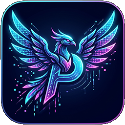
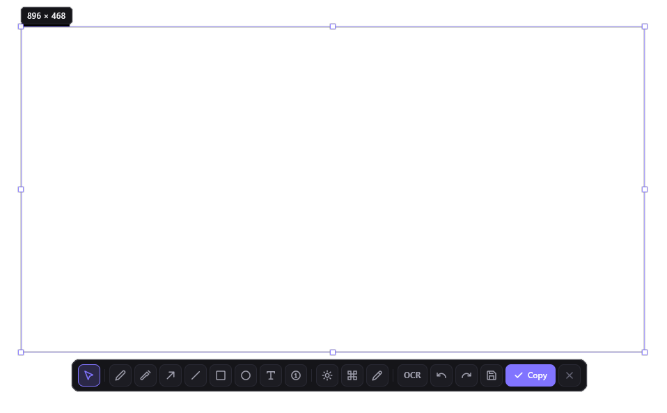

<div align="center">



# Pixora

**GPU-ускоренная студия создания скриншотов и аннотаций для Windows 10 и 11**

*Молниеносная альтернатива CleanShot X, разработанная на чистом Rust и GPUI.*

[English](README.md) • [Русский](README.ru.md)

[](https://www.rust-lang.org/)
[-blueviolet.svg?style=flat-square)](https://github.com/zed-industries/zed)
[](https://microsoft.com)
[]()
[]()
[]()

---



*Интерфейс Pixora: плавающая панель инструментов в стиле CleanShot X, пиксельная лупа в реальном времени и холст аннотаций.*

---

</div>

<br/>

## 🚀 О проекте
**Pixora** — профессиональная, высокопроизводительная утилита для создания скриншотов и аннотаций, созданная специально для **Windows 10 и 11**. Вдохновленная легкостью и эстетикой CleanShot X на macOS, Pixora объединяет пиксельную точность, богатый набор векторных инструментов рисования, локальный OCR и мгновенную работу с буфером обмена в компактном нативном приложении.

Pixora работает **на 100% локально и автономно**. Без облачных серверов, скрытой телеметрии, веб-надстроек и отправки данных в сеть.

---

## 🛠️ На чем написана (Технологический стек)
Архитектура Pixora спроектирована для максимальной производительности, мгновенного отклика и минимального потребления памяти:

- **Язык разработки:** **Чистый Rust (Edition 2024)** — безопасность памяти, отсутствие сборок мусора (GC), высочайшая скорость скомпилированного машинного кода.
- **Графический UI-фреймворк:** **[GPUI](https://github.com/zed-industries/zed)** — гибридный GPU-ускоренный движок рендеринга редактора Zed, работающий через DirectX 11/12. Обеспечивает стабильные 60+ FPS, плавные анимации, векторную отрисовку и отклик на действия мыши с минимальной задержкой.
- **Системный слой Windows:** Прямой **Win32 API** (`windows-rs` 0.61):
  - **GDI BitBlt** — моментальный захват виртуального рабочего стола без цветовых искажений и артефактов на любых конфигурациях мониторов.
  - **Windows Runtime OCR (`Windows.Media.Ocr`)** — аппаратное оптическое распознавание печатного текста прямо на устройстве.
  - **Per-Monitor V2 HiDPI** — идеальная резкость и соответствие пикселей при масштабировании от 100% до 300%.
  - **Shell NotifyIcon** — бесшовный фоновый демон в системном трее Windows.
  - **RegisterHotKey** — глобальный перехват горячих клавиш в отдельном потоке.
- **Размер и ресурсы:** Единый автономный `.exe` файл (~12.7 МБ). **Полный отказ от Electron, Tauri, WebView, Chromium, Python и Node.js.** Потребление оперативной памяти в фоне — менее 40 МБ.

---

## ✨ Ключевые возможности

### 1. Точный захват экрана и поддержка нескольких дисплеев
- **Захват произвольной области:** Интерактивное выделение мышью с выводом актуальных размеров (Ш × В в пикселях).
- **Полноэкранный снимок:** Мгновенный снимок всего виртуального экрана со всеми подключенными дисплеями (`Shift + PrintScreen`).
- **Снимок активного окна:** Фиксация окна, находящегося в фокусе (`Alt + PrintScreen`).
- **Мультимониторность:** Корректная поддержка мониторов с разным разрешением, ориентацией и отрицательными координатами.
- **Чистый захват:** Снимок экрана фиксируется *до* показа интерфейса, исключая попадание элементов управления на готовое изображение.

### 2. Дизайн CleanShot X и пиксельная лупа
- **Темная стеклянная эстетика:** Премиальная палитра (`#0B0B0D` / `#151519` / `#8174FF`) без стандартных оконных рамок Windows.
- **8 интерактивных маркеров:** Изменение размера за любую сторону или угол с автоматической нормализацией координат.
- **Лупа (Magnifier) и Пипетка:** Увеличенная сетка пикселей под курсором с координатами (X, Y) и моментальным определением цвета.
- **Адаптивная плавающая панель:** Центрируется относительно рамки выделения, размещается сверху или снизу и надежно удерживается в границах экрана.
- **Всплывающие подсказки:** Подробные описания для всех кнопок при наведении.

### 3. Богатый арсенал аннотаций
- **Карандаш (Pencil):** Плавное рисование произвольных линий с выбранной толщиной.
- **Маркер / Хайлайтер (Marker):** Полупрозрачный слой (35% непрозрачности) для выделения строк кода и текста.
- **Стрелка (Arrow):** Векторная стрелка с четким треугольным наконечником.
- **Прямая линия (Line):** Точные направляющие под любым углом.
- **Прямоугольник (Rectangle):** Контурные и сплошные прямоугольники.
- **Эллипс / Круг (Ellipse):** Идеально сглаженные эллипсы на кубических кривых Безье.
- **Текст (Text):** Ввод текста прямо на холсте с поддержкой кириллицы/русской раскладки, клавиши Backspace и переключением размера шрифта (14, 18, 24 px).
- **Нумерованные шаги (Step Badges):** Последовательные метки (1, 2, 3...) с автоматическим инкрементом номера при каждом клике.
- **Размытие по Гауссу (Blur):** Двухпроходное блюр-сглаживание конфиденциальных данных с пошаговой регулировкой (`[-] 12px [+]`) и пресетами (`Soft 6px`, `Medium 12px`, `Strong 24px`, `Heavy 36px`).
- **Пикселизация (Pixelate):** Мозаичное скрытие областей с настройкой размера блоков (`[-] 10px [+]`).
- **Настройка толщины штриха:** От 1 до 48 px с помощью кнопок `[-]` / `[+]`, пресетов или колесика мыши.
- **Неразрушающая история:** Неограниченные отмена (`Ctrl + Z`) и повтор (`Ctrl + Y`) без деградации исходного снимка.

### 4. Профессиональная палитра RGB Color Studio
- **Полный спектр 24-bit RGB (16.7 млн цветов):** Выбор любого существующего оттенка.
- **360° радужная шкала Hue:** Плавный спектр тонов с конвертацией HSV ↔ RGB.
- **Раздельные регуляторы каналов R, G, B:** Кнопки быстрой подстройки (`-10`, `-1`, `+1`, `+10`) и числовые поля (0–255).
- **Поддержка форматов цвета:** Отображение HEX (`#RRGGBB`), RGB, HSV, HSL, прямой ввод HEX с клавиатуры и кнопка быстрого копирования цвета.
- **Быстрые цвета:** Палитра эталонных дизайнерских оттенков для мгновенного выбора.

### 5. Локальный OCR (Распознавание текста)
- Встроенное оптическое распознавание на базе нативного движка `Windows.Media.Ocr.OcrEngine`.
- Распознает русский, английский и смешанный текст без интернета.
- Скопированный текст сразу помещается в буфер обмена.

### 6. Экспорт и мгновенная вставка
- **Копирование в буфер (`Ctrl + C` / Enter):** Запись нативного Windows-формата `CF_DIB`. Изображение со всеми аннотациями вставляется в Telegram, Discord, Photoshop, браузеры и офисные пакеты нажатием `Ctrl + V`.
- **Сохранение в PNG (`Ctrl + S`):** Беспотерьное сжатие PNG с автоматической генерацией имени по времени: `Pixora_YYYY-MM-DD_HHMMSS.png`.
- **Звук затвора:** Приятный ненавязчивый щелчок камеры при успешном захвате.
- **Всплывающие уведомления (Toasts):** Информативные CleanShot-уведомления об операциях.

### 7. Системный трей и глобальные горячие клавиши
- Работа в фоновом режиме без открытия консольных окон.
- Меню в системном трее Windows:
  - Сделать скриншот (`PrintScreen`)
  - Снимок всего экрана (`Shift + PrintScreen`)
  - Снимок окна (`Alt + PrintScreen`)
  - Настройки
  - Открыть папку скриншотов
  - Выход
- Надежные глобальные хоткеи через Win32 API.

### 8. Окно настроек (Settings Hub)
- Нативное окно на GPUI (720 × 560 px).
- **Раздел General:** Автозапуск с Windows через системный реестр, автокопирование в буфер, звуковые эффекты, выбор папки сохранения и открытие в Проводнике.
- **Раздел Capture:** Настройка лупы, отображения размеров и базовой толщины линий.
- **Раздел Shortcuts:** **Интерактивное переназначение горячих клавиш** прямо из интерфейса с немедленной перерегистрацией в Windows.
- **Раздел About:** Версия программы, сведения об архитектуре и авторстве.

---

## ⌨️ Таблица горячих клавиш

| Сочетание | Описание действия | Настраивается |
|---|---|:---:|
| `PrintScreen` | Захват произвольной области экрана | Да |
| `Shift + PrintScreen` | Мгновенный снимок всего виртуального экрана | Да |
| `Alt + PrintScreen` | Снимок текущего активного окна | Да |
| `Ctrl + C` / `Enter` | Скопировать готовый скриншот в буфер обмена | Нет |
| `Ctrl + S` | Сохранить скриншот в файл PNG | Нет |
| `Ctrl + Z` | Отменить последнее действие (Undo) | Нет |
| `Ctrl + Y` | Повторить отмененное действие (Redo) | Нет |
| `Escape` | Сбросить выделение / выйти из оверлея | Нет |
| `Колесико мыши` | Изменить толщину текущего инструмента | Нет |

---

## 📦 Сборка из исходников

### Системные требования
- 64-битная операционная система Windows 10 или Windows 11.
- Установленный компилятор Rust (версия 1.82 или новее).

### Инструкция по сборке
```bash
# Клонирование репозитория
git clone https://github.com/Onzis/PIXORA.git
cd PIXORA

# Проверка типов и кода
cargo check

# Запуск набора тестов
cargo test

# Сборка оптимизированного релиза с встроенными ресурсами и иконкой
cargo build --release
```

Готовый бинарный файл создается по пути:
```text
target/release/pixora.exe
```

---

## 👤 Автор и лицензия
- **Автор:** **Onzi**
- **Проект:** **Pixora**
- **Лицензия:** [MIT License](LICENSE)
