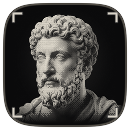
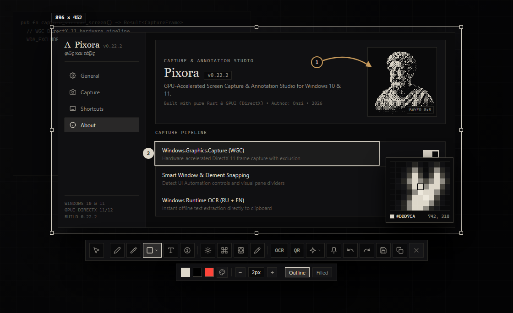

<div align="center">



# Pixora

**GPU-ускоренная студия создания скриншотов и аннотаций для Windows**

*Молниеносная альтернатива CleanShot X, разработанная на чистом Rust и GPUI.*

[English](README.md) • [Русский](README.ru.md)

[](https://www.rust-lang.org/)
[-blueviolet.svg?style=flat-square)](https://github.com/zed-industries/zed)
[](https://www.microsoft.com/windows)
[](https://github.com/Onzis/Pixora/releases)
[](https://github.com/Onzis)
[](https://www.apache.org/licenses/LICENSE-2.0)

---



*Интерфейс Pixora: плавающая панель инструментов в стиле CleanShot X, пиксельная лупа в реальном времени и холст аннотаций.*

---

</div>

## О проекте
**Pixora** - профессиональная, высокопроизводительная утилита для создания скриншотов и аннотаций, созданная специально для **Windows 10 и 11**. Вдохновленная легкостью и эстетикой CleanShot X на macOS, Pixora объединяет пиксельную точность, богатый набор векторных инструментов рисования, локальный OCR, умную привязку к элементам интерфейса и мгновенную работу с буфером обмена в компактном нативном приложении.

Pixora работает **на 100% локально и автономно**. Без облачных серверов, скрытой телеметрии, веб-надстроек и отправки данных в сеть.

---

## На чем написана (Технологический стек)
Архитектура Pixora спроектирована для максимальной производительности, мгновенного отклика и минимального потребления памяти:

- **Язык разработки:** **Чистый Rust (Edition 2024)** - безопасность памяти, отсутствие сборок мусора (GC), высочайшая скорость машинного кода.
- **Графический UI-фреймворк:** **[GPUI](https://github.com/zed-industries/zed)** - гибридный GPU-ускоренный движок рендеринга редактора Zed, работающий поверх DirectX 11/12. Обеспечивает стабильные 60+ FPS, векторную отрисовку и отклик на действия мыши с минимальной задержкой.
- **Нативный системный слой:** Прямой **Win32 & WinRT API** (`windows-rs` 0.61):
  - **Windows.Graphics.Capture (WGC):** Аппаратно-ускоренный захват через DirectX 11, поддержка защищенного контента, мультимониторная композиция и аппаратное исключение окна Pixora из кадра через `SetWindowDisplayAffinity(WDA_EXCLUDEFROMCAPTURE)`.
  - **GDI BitBlt Fallback:** Мгновенный fallback для виртуального рабочего стола любой конфигурации.
  - **Windows Runtime OCR (`Windows.Media.Ocr`):** Локальное распознавание текста на устройстве.
  - **Per-Monitor V2 HiDPI:** Идеальная резкость при масштабировании от 100% до 300%.
  - **Shell NotifyIcon & RegisterHotKey:** Системный трей и глобальные горячие клавиши.
- **Размер и ресурсы:** Единый автономный бинарный файл. **Полный отказ от Electron, Tauri, WebView, Chromium, .NET Runtime и Node.js.** Потребление оперативной памяти в фоне - менее 40 МБ.

---

## Ключевые возможности

### 1. Точный захват экрана и поддержка нескольких дисплеев
- **Захват произвольной области:** Интерактивное выделение мышью с выводом актуальных размеров (Ш x В в пикселях).
- **Полноэкранный снимок:** Мгновенный снимок всего виртуального экрана со всеми подключенными дисплеями (`Shift + PrintScreen`).
- **Снимок активного окна:** Фиксация окна, находящегося в фокусе (`Alt + PrintScreen`).
- **Умная привязка к окнам и элементам:** Распознавание границ окон, дочерних элементов и визуальных панелей через Windows UI Automation и пиксельный алгоритм детекции разделителей (`detect_visual_panes`).
- **Аппаратное исключение из захвата:** Окна оверлея Pixora не попадают в итоговый кадр благодаря `WDA_EXCLUDEFROMCAPTURE`.
- **Мультимониторность:** Корректная поддержка мониторов с разным разрешением, ориентацией и отрицательными координатами.

### 2. Дизайн CleanShot X и пиксельная лупа
- **Темная стеклянная эстетика:** Премиальная палитра (`#0B0B0D` / `#151519` / `#8174FF`) без стандартных оконных рамок.
- **8 интерактивных маркеров:** Изменение размера за любую сторону или угол с автоматической нормализацией координат.
- **Лупа (Magnifier) и Пипетка:** Увеличенная сетка пикселей под курсором с координатами (X, Y) и моментальным определением цвета.
- **Адаптивная плавающая панель:** Центрируется относительно рамки выделения, размещается сверху или снизу и удерживается в границах экрана.
- **Всплывающие подсказки:** Подробные описания для всех кнопок при наведении.

### 3. Богатый арсенал аннотаций
- **Карандаш (Pencil):** Плавное рисование произвольных линий с выбранной толщиной.
- **Маркер / Хайлайтер (Marker):** Полупрозрачный слой (35% непрозрачности) для выделения строк кода и текста.
- **Стрелка (Arrow):** Векторная стрелка с четким треугольным наконечником и поддержкой изогнутых кривых Безье.
- **Прямая линия (Line):** Точные направляющие под любым углом.
- **Прямоугольник (Rectangle):** Контурные и сплошные прямоугольники со скруглением.
- **Эллипс / Круг (Ellipse):** Идеально сглаженные эллипсы на кубических кривых Безье.
- **Текст (Text):** Редактор текста прямо на холсте со свободным масштабированием рамки, автопереносом строк и поддержкой кириллицы/русской раскладки.
- **Нумерованные шаги (Step Badges):** Последовательные цифровые (1, 2, 3...) или буквенные (A, B, C...) метки с автоматическим инкрементом.
- **Размытие по Гауссу (Blur):** Двухпроходное блюр-сглаживание с пошаговой регулировкой (`[-] 12px [+]`) и пресетами (`Soft 6px`, `Medium 12px`, `Strong 24px`, `Heavy 36px`).
- **Пикселизация (Pixelate):** Мозаичное скрытие областей с настройкой размера блоков (`[-] 10px [+]`).
- **Настройка толщины штриха:** От 1 до 48 px с помощью кнопок `[-]` / `[+]`, пресетов или колесика мыши.
- **Неразрушающая история:** Неограниченные отмена (`Ctrl + Z`) и повтор (`Ctrl + Y`) без деградации исходного снимка.

### 4. Профессиональная палитра RGB Color Studio
- **Полный спектр 24-bit RGB (16.7 млн цветов):** Выбор любого существующего оттенка.
- **360° радужная шкала Hue:** Плавный спектр тонов с конвертацией HSV <-> RGB.
- **Раздельные регуляторы каналов R, G, B:** Кнопки быстрой подстройки (`-10`, `-1`, `+1`, `+10`) и числовые поля (0-255).
- **Поддержка форматов цвета:** Отображение HEX (`#RRGGBB`), RGB, HSV, HSL, прямой ввод HEX с клавиатуры и кнопка быстрого копирования цвета.
- **Быстрые цвета:** Палитра эталонных дизайнерских оттенков для мгновенного выбора.

### 5. Локальный OCR (Распознавание текста)
- Встроенное автономное оптическое распознавание на базе Windows Runtime (`Windows.Media.Ocr`).
- Распознает русский, английский и смешанный текст без интернета.
- Интерактивное окно с объединением строк в одну строку, форматированием таблиц с табуляцией и сохранением отступов кода.
- Копирование распознанного текста в буфер обмена в один клик.

### 6. Экспорт и мгновенная вставка
- **Копирование в буфер (`Ctrl + C` / Enter):** Запись одновременно двух нативных форматов (`CF_DIBV5` + `PNG`) в буфер обмена Windows. Изображение со всеми аннотациями вставляется в Telegram, Discord, Photoshop, браузеры и мессенджеры нажатием `Ctrl + V`.
- **Сохранение в PNG (`Ctrl + S`):** Беспотерьное сжатие PNG с автоматической генерацией имени по времени: `Pixora_YYYY-MM-DD_HHMMSS.png`.
- **Звук затвора:** Ненавязчивый щелчок камеры при захвате.
- **Всплывающие уведомления (Toasts):** Нативные Windows-уведомления о копировании и сохранении.

### 7. Системный трей и глобальные горячие клавиши
- Работает в фоновом режиме в области уведомлений Windows (`NotifyIcon`) без консольных окон.
- Регистрация глобальных сочетаний клавиш средствами Win32 API.

### 8. Нативный центр настроек
- GPUI-окно конфигурации.
- **Основные:** Автозапуск с Windows, автокопирование в буфер, звуки затвора, папка сохранения снимков.
- **Захват:** Настройка лупы, отображения размеров и базовой толщины пера.
- **Горячие клавиши:** Интерактивное переназначение сочетаний клавиш прямо из интерфейса.
- **О программе:** Информация о версии, архитектуре и авторе.

---

## Горячие клавиши по умолчанию

| Сочетание клавиш | Описание | Настраивается |
|---|---|:---:|
| `PrintScreen` | Захват выбранной области | Да |
| `Shift + PrintScreen` | Захват всего виртуального экрана | Да |
| `Alt + PrintScreen` | Захват текущего активного окна | Да |
| `Ctrl + C` / `Enter` | Скопировать снимок в буфер обмена | Нет |
| `Ctrl + S` | Сохранить снимок в PNG-файл | Нет |
| `Ctrl + Z` | Отменить последнее действие | Нет |
| `Ctrl + Y` | Повторить действие | Нет |
| `Escape` | Отменить выделение / закрыть оверлей | Нет |
| `Колесико мыши` | Увеличить / уменьшить толщину штриха | Нет |

---

## Сборка из исходного кода

### Системные требования
- Windows 10 или 11 (x64)
- Rust toolchain (stable, edition 2024)

### Команды сборки

```powershell
# Клонирование репозитория
git clone https://github.com/Onzis/Pixora.git
cd Pixora

# Проверка компиляции и типов
cargo check

# Запуск полного набора автотестов (53 юнит- и интеграционных теста)
cargo test

# Сборка оптимизированного релизного бинарника
cargo build --release
```

Готовый автономный файл формируется в `target/release/Pixora.exe`.

---

## Автор и лицензия
- **Автор:** **Onzi**
- **Проект:** **Pixora**
- **Лицензия:** [Apache-2.0 License](https://www.apache.org/licenses/LICENSE-2.0)
